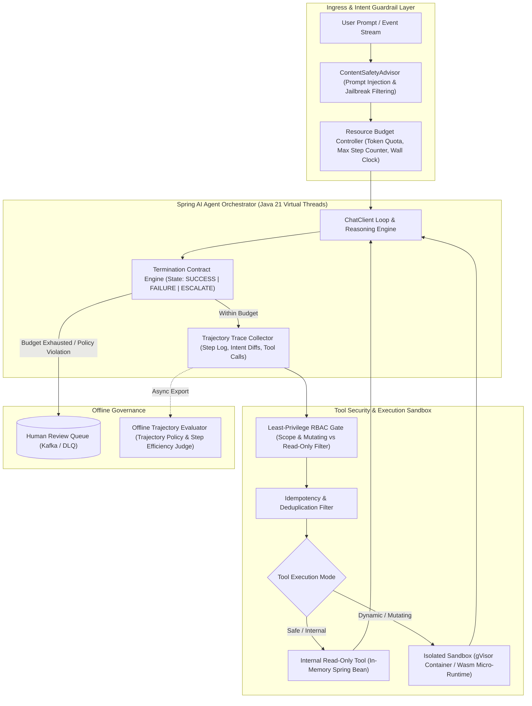
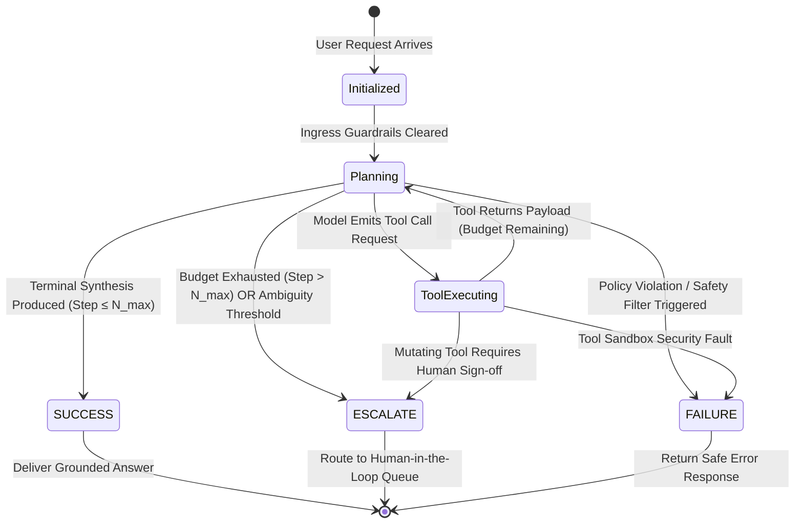
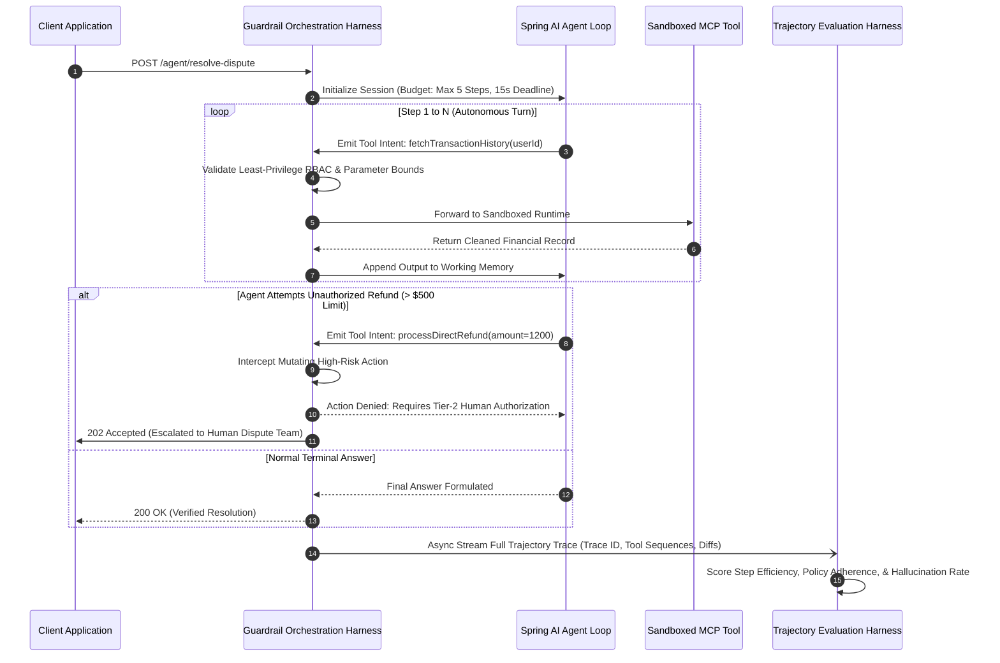

# Enterprise Agentic Guardrails: Architecting Termination Contracts, Trajectory Evaluation, and Tool Sandboxing


## Autonomous Reasoning Loops Multiply Failure Blast Radius Beyond Traditional Chatbots

In classical request-response architectures, an API call executes deterministically within bounded execution limits: you send a payload, invoke a service, and receive a response. In contrast, agentic AI operates through iterative loops—perceiving state, planning action sequences, executing tools via protocols like the Model Context Protocol (MCP), observing environmental feedback, and re-planning.

When deployed into enterprise production, unconstrained agentic loops introduce severe systemic failure modes:

* **The Unbounded Loop Trap:** When an agent encounters ambiguous tool output, schema mismatch, or API rate-limiting, it often re-queries with slight variations indefinitely. Without explicit stopping constraints, an autonomous agent can burn thousands of dollars in LLM inference costs and swamp downstream microservices in minutes.

* **Unscoped Tool Permissions & Side-Effect Collisions:** Granting an agentic service broad database or HTTP client permissions allows single prompts to trigger unintended mutations. An agent retrying an order placement without idempotency guarantees can execute duplicate charges or corrupt inventory records.

* **The "Output-Only" Evaluation Blindspot:** Traditional ML testing evaluates the final text output of a model against a reference string. In agentic workflows, an agent might arrive at a "correct" final answer through an illegal sequence of tool calls—bypassing security checks, reading unauthorized tenant partitions, or taking fifteen redundant steps.

* **Shared-Memory Container Vulnerabilities:** Executing dynamic agent-generated code or untrusted tool transformations inside the same JVM or container runtime risks arbitrary code execution, environment variable leakage, and denial of service across tenant boundaries.

## The Defense-in-Depth Agentic Architecture Enforces Multi-Layered Policy Boundaries

To safely harness autonomous agentic capabilities, enterprise platforms construct a multi-layered guardrail boundary separating user intent, planning logic, tool invocation, and physical environment execution.



## Bounded Termination Contracts Transition Agents to Deterministic Exit States

A production-grade agentic system requires a formal **Termination Contract**: a state machine that guarantees every execution path terminates deterministically within predefined budgets, regardless of model hallucinations or transient dependency failures.

A termination contract enforces three complementary constraints:

1. **Hard Step Ceiling (**$N_{max}$**):** The maximum number of autonomous tool-calling iterations permitted per user request (typically 5 to 10 steps). If the model fails to reach a terminal answer within $N_{max}$ turns, the runtime forcefully suspends execution.

2. **Cumulative Token & Financial Cap:** Maximum combined input and output tokens across all reasoning steps.

3. **Wall-Clock Deadline:** Strict end-to-end timeout enforced via virtual thread interruption or StructuredTaskScope deadlines.

When a budget limit is violated, the termination engine transitions the session into one of three explicit terminal states rather than returning an ungrounded hallucination:



## Multi-Step Trajectory Evaluation Benchmarks Agent Behavior Across Tool Sequences

Unlike chatbot evaluation, which only inspects the final markdown payload, **Trajectory Evaluation** inspects the entire directed acyclic graph (DAG) of an agent's reasoning steps, tool choices, arguments, and intermediate recovery paths.

As demonstrated, high-performing agents are distinguished by their trajectory discipline:

* **Step Efficiency Ratio:** The ratio of required operational actions to total executed actions ($\frac{\text{Optimal Steps}}{\text{Actual Steps}}$). Penalizes repetitive tool looping and circular context searches.

* **Tool Argument Soundness:** Validates whether the parameters passed to Spring AI Tool Calling match schema constraints and RBAC scope before network dispatch.

* **Prohibited Path Detection:** Flags trajectories where an agent attempts unauthorized actions (e.g., querying private user tables or executing raw SQL) even if subsequent steps recover.

* **Error Recovery Resilience:** Measures how gracefully the agent handles a simulated downstream error (e.g., HTTP 503 from an MCP server) without hallucinating fictional tool responses.



## Production Case Studies Detail Enterprise Agent Outages and Sandboxing Solutions

### Case Study 1: The Autonomous PR Bot Double-Spend and Infinite Refinement Loop

As documented in industry postmortems, an enterprise deployed an unattended agentic assistant connecting customer service agents to ERP, ticketing, and payment APIs:

1. **The Trigger:** A customer submitted a ticket with ambiguous formatting containing conflicting order numbers.

2. **The Failure Cascade:** The agent queried the order database, received an empty result set, reasoned that the query was flawed, and modified query parameters in a tight loop. Because no termination contract was configured, the agent cycled 142 times across 12 minutes, exceeding API rate limits and generating a \$480 single-session token bill.

3. **The Mutating Blunder:** In step 114, the model hypothesized that the order had failed to post and invoked the `createOrder` and `chargeCustomer` tools using guessed metadata, creating an unbacked double-charge.

4. **Architectural Fix:** The engineering team introduced a strict 6-step termination contract, decoupled read tools from mutating tools via separate OAuth2 scopes, and instituted mandatory human-in-the-loop escalation for any transaction exceeding \$100.

### Case Study 2: How companies Sandbox Agent Tool Execution

Autonomous coding and workflow agents execute untrusted bash scripts, code generation, and external API queries. Running these commands directly inside host microservice processes would expose cloud metadata endpoints and internal VPC networks to prompt injection:

* **Kernel Isolation with gVisor / MicroVMs:** Untrusted tool execution runs inside ephemeral micro-sandboxes managed via gVisor (which intercepts host kernel system calls in userspace) or lightweight Firecracker microVMs.

* **Network Egress Filtering:** Sandboxed agents have default-deny egress policies. Connections are permitted solely to whitelisted API endpoints with strict rate limiting and ephemeral JWT credential injection.

## Reference Implementation Implements Spring AI Guardrails and Bounded Advisors

The following Java 21+ implementation illustrates an enterprise Spring AI guardrail architecture using custom `CallAroundAdvisor` filters to enforce sexecution, and trajectory auditing.

```java
package com.architecture.agentic.guardrails;

import org.slf4j.Logger;
import org.slf4j.LoggerFactory;
import org.springframework.ai.chat.client.ChatClient;
import org.springframework.ai.chat.client.advisor.api.AdvisedRequest;
import org.springframework.ai.chat.client.advisor.api.AdvisedResponse;
import org.springframework.ai.chat.client.advisor.api.CallAroundAdvisor;
import org.springframework.ai.chat.client.advisor.api.CallAroundAdvisorChain;
import org.springframework.ai.chat.model.ChatResponse;
import org.springframework.stereotype.Component;

import java.time.Duration;
import java.time.Instant;
import java.util.concurrent.ConcurrentHashMap;
import java.util.concurrent.atomic.AtomicInteger;

/**
 * Enforces strict termination contracts, maximum reasoning steps,
 * and trajectory auditing across autonomous Spring AI tool loops.
 */
@Component
public class BoundedAgentTerminationAdvisor implements CallAroundAdvisor {

    private static final Logger log = LoggerFactory.getLogger(BoundedAgentTerminationAdvisor.class);
    private static final int MAX_REASONING_STEPS = 6;
    private static final Duration MAX_SESSION_DURATION = Duration.ofSeconds(20);

    private final ConcurrentHashMap<String, SessionBudget> activeBudgets = new ConcurrentHashMap<>();

    @Override
    public AdvisedResponse aroundCall(AdvisedRequest advisedRequest, CallAroundAdvisorChain chain) {
        String sessionId = (String) advisedRequest.adviseContext().getOrDefault("SESSION_ID", "default-session");
        
        SessionBudget budget = activeBudgets.computeIfAbsent(sessionId, id -> new SessionBudget(Instant.now()));
        int currentStep = budget.stepCounter.incrementAndGet();

        // 1. Enforce Wall-Clock Deadline Contract
        if (Duration.between(budget.startTime, Instant.now()).compareTo(MAX_SESSION_DURATION) > 0) {
            log.warn("Session {} exceeded wall-clock deadline of {}s. Forcing escalation.", sessionId, MAX_SESSION_DURATION.toSeconds());
            return createEscalationResponse(advisedRequest, "SESSION_TIMEOUT_EXCEEDED");
        }

        // 2. Enforce Hard Step Ceiling Contract
        if (currentStep > MAX_REASONING_STEPS) {
            log.warn("Session {} exceeded maximum reasoning steps ({}). Terminating loop.", sessionId, MAX_REASONING_STEPS);
            return createEscalationResponse(advisedRequest, "MAX_REASONING_STEPS_EXCEEDED");
        }

        log.info("Executing Agent Turn - Session: {}, Step: {}/{}", sessionId, currentStep, MAX_REASONING_STEPS);

        // 3. Delegate to Agent Execution Chain with Trajectory Logging
        Instant turnStart = Instant.now();
        AdvisedResponse response = chain.nextAroundCall(advisedRequest);
        Duration turnDuration = Duration.between(turnStart, Instant.now());

        log.info("Agent Turn Completed - Session: {}, Step: {}, Duration: {}ms", 
                sessionId, currentStep, turnDuration.toMillis());

        return response;
    }

    private AdvisedResponse createEscalationResponse(AdvisedRequest request, String reason) {
        ChatResponse fallbackChatResponse = ChatResponse.builder()
                .build(); // Constructs bounded terminal escalation signal for human queue
        
        return AdvisedResponse.builder()
                .response(fallbackChatResponse)
                .adviseContext(request.adviseContext())
                .build();
    }

    @Override
    public int getOrder() {
        return 0; // Highest precedence in advisor chain
    }

    @Override
    public String getName() {
        return "BoundedAgentTerminationAdvisor";
    }

    private record SessionBudget(Instant startTime, AtomicInteger stepCounter) {
        public SessionBudget(Instant startTime) {
            this(startTime, new AtomicInteger(0));
        }
    }
}
```

## Architectural Trade-Off Matrix Compares Agent Tool Sandboxing Isolation Levels

When designing sandbox environments for agent tool calling and code execution, architects must evaluate startup latency, tenant isolation depth, and operational complexity ([Northflank Agent Sandboxing Analysis](https://www.google.com/search?q=https%3A%2F%2Fnorthflank.com%2Fblog%2Fhow-to-sandbox-ai-agents)):

| Sandboxing Technology | Startup Latency | Memory Overhead per Instance | Kernel Isolation Boundary | Blast Radius Protection | Primary Use Case | 
| ----- | ----- | ----- | ----- | ----- | ----- | 
| **In-Process JVM ClassLoader / SecurityManager** | < 1 ms | Negligible (< 1 MB) | None (Shared OS & JVM Heap) | Vulnerable to memory exhaustion & JNI escapes | Read-only verified enterprise microservice beans | 
| **Standard Docker Container (`runc`)** | 500 ms – 2s | 20 MB – 50 MB | Weak (Shared Host Kernel via cgroups/namespaces) | Vulnerable to container escape exploits (CVEs) | Trusted internal batch processing tasks | 
| **User-Space Kernel Interception (`gVisor`)** | 50 ms – 200 ms | 15 MB – 30 MB | Strong (Virtual Sentry Kernel intercepts syscalls) | Blocks direct kernel access and host filesystem compromise | Untrusted tool execution, Python scripts, & dynamic MCP servers | 
| **WebAssembly Micro-Runtime (Wasm / WASI)** | < 5 ms | < 5 MB | Strong (Capability-based memory sandboxing) | Complete memory isolation; zero network without explicit import | High-throughput stateless transformations & edge tool logic | 
| **Hardware-Virtual MicroVM (Firecracker / Kata)** | 100 ms – 300 ms | 50 MB – 100 MB | Maximum (Independent guest Linux kernel via KVM) | Hypervisor-level boundary with complete hardware isolation | Multi-tenant untrusted code compilation and enterprise PR bots | 